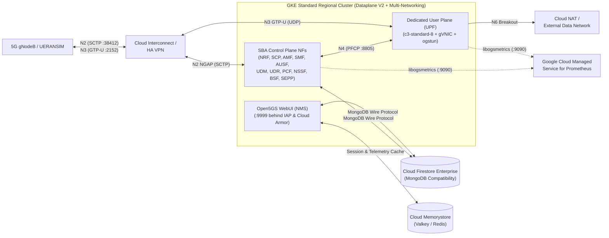

# Open5GS 5G Standalone (5G SA) Core Blueprint on Google Cloud Platform

This repository provides a **Principal Architect Reference Blueprint**, **Terraform Infrastructure-as-Code (IaC)** templates, and **Google Kubernetes Engine (GKE)** manifests for deploying a complete **3GPP Release-17/18 Open5GS 5G Standalone (5G SA) Core**—including the **User Plane Function (UPF)** and **Network Management System (NMS)**—100% within a **Google Cloud Public Region**.

---

## Architecture Overview



### Key GCP Native Service Mappings
| 5GS Layer | Open5GS Component | Google Cloud Native Service |
| :--- | :--- | :--- |
| **Control Plane (SBA)** | `NRF`, `SCP`, `AMF`, `SMF`, `AUSF`, `UDM`, `UDR`, `PCF`, `NSSF`, `BSF`, `SEPP` | **GKE Standard** (`Dataplane V2` + HTTP/2 Services + Multi-NIC for `N2`/`N4`) |
| **User Plane (CUPS)** | `UPF` (`open5gs-upfd` + `ogstun` kernel TUN) | **GKE Standard C3 Node Pool** (`c3-standard-8`, `gVNIC`, Multi-NIC `N3`/`N4`/`N6` with `MTU 8896`, **Cloud NAT**) |
| **Subscriber & Policy DB** | MongoDB (`udrd`, `pcfd`, `webui`) | **Cloud Firestore Enterprise with MongoDB Compatibility** *(or MongoDB Atlas on GCP)* |
| **In-Memory Database** | Session Cache, Policy Cache, & UDSF Adapter | **Cloud Memorystore for Valkey / Redis Cluster** (`STANDARD_HA`) |
| **Network Management System (NMS)** | `open5gs-webui` + `libogsmetrics` (`:9090`) + NF Logs | **Cloud Load Balancing** + **Identity-Aware Proxy (IAP)** + **Cloud Armor** + **Managed Service for Prometheus (GMP)** + **Cloud Monitoring / Logging** + **GKE Config Sync** |
| **5GS E2E Simulation Suite** | **UERANSIM** (`nr-gnb` + `nr-ue`) & **Open5GS Native C Test Suite** (`meson test`) | **GKE Multi-NIC Simulator Pods** (`net1=N2 SCTP`, `net2=N3 GTP-U`, `uesimtun0`) + **GKE Conformance Job** |

---

## Repository Structure

```text
.
├── README.md                                 # Repository overview and quickstart guide
├── design_blueprint.md                       # Comprehensive 5G Principal Architect Design Blueprint
├── .gitignore                                # Excludes Terraform state, GCP credentials, and SIM keys
├── terraform/
│   ├── main.tf                               # Multi-VPC (SBI, N2, N3, N4, N6), GKE Dataplane V2, Firestore, Memorystore
│   └── variables.tf                          # Parameterized GCP project, region, PLMN (MCC/MNC), and CIDRs
└── k8s/
    ├── 00-namespace-and-networks.yaml        # Namespace & GKE Multi-Network CRDs (N2, N3, N4, N6)
    ├── 01-control-plane-sba.yaml             # Full 5G SA Control Plane NFs + Managed Prometheus PodMonitoring
    ├── 02-upf-user-plane.yaml                # Multi-NIC UPF StatefulSet with ogstun & N6 NAT masquerade
    ├── 03-nms-webui-iap.yaml                 # Open5GS WebUI NMS behind External ALB, Cloud Armor, & IAP
    └── 04-ueransim-ran-ue-simulator.yaml     # In-Cluster UERANSIM (gNodeB + UE) & Open5GS Native C Conformance Job
```

---

## Quickstart Deployment Guide

### 1. Provision GCP Infrastructure with Terraform
```bash
cd terraform
terraform init
terraform plan -var="project_id=<YOUR_GCP_PROJECT_ID>" -var="region=us-central1"
terraform apply -var="project_id=<YOUR_GCP_PROJECT_ID>" -var="region=us-central1"
```

### 2. Configure GKE Credentials & Secrets
```bash
gcloud container clusters get-credentials open5gs-5gc-cluster --region=us-central1 --project=<YOUR_GCP_PROJECT_ID>

# Create namespace and multi-NIC network attachments
kubectl apply -f ../k8s/00-namespace-and-networks.yaml

# Store Firestore (MongoDB-compatible) URI and Memorystore URI in Kubernetes Secrets
kubectl -n open5gs create secret generic open5gs-db-secret \
  --from-literal=db_uri="mongodb://<USER>:<PASS>@<FIRESTORE_MONGO_ENDPOINT>:27017/open5gs?tls=true"

kubectl -n open5gs create secret generic open5gs-redis-secret \
  --from-literal=redis_uri="redis://<MEMORYSTORE_ENDPOINT>:6379"
```

### 3. Deploy 5G SA Control Plane, User Plane (UPF), & NMS
```bash
# Deploy SBA Control Plane NFs (NRF, SCP, UDR, UDM, AUSF, PCF, NSSF, BSF, SEPP, AMF, SMF)
kubectl apply -f ../k8s/01-control-plane-sba.yaml

# Deploy Multi-NIC User Plane Function (UPF)
kubectl apply -f ../k8s/02-upf-user-plane.yaml

# Deploy Open5GS WebUI Network Management System (NMS) with IAP
kubectl apply -f ../k8s/03-nms-webui-iap.yaml
```

### 4. Simulate the Complete 5GS (UE + gNodeB + Data Path)
```bash
# Deploy UERANSIM (nr-gnb + nr-ue) & Open5GS Native C Conformance Test Job
kubectl apply -f ../k8s/04-ueransim-ran-ue-simulator.yaml

# Check Open5GS Native 3GPP Registration & Slicing Conformance Test logs
kubectl -n open5gs logs job/open5gs-native-5gc-conformance-test

# Verify UERANSIM UE Registration & PDU Session Tunnel (uesimtun0)
kubectl -n open5gs logs deploy/ueransim-ue

# Send live User Plane traffic from the simulated UE through UPF (ogstun) -> N6 Internet
kubectl -n open5gs exec -it deploy/ueransim-ue -- ping -I uesimtun0 -c 5 8.8.8.8
kubectl -n open5gs exec -it deploy/ueransim-ue -- curl --interface uesimtun0 -I https://www.google.com
```

---

## Architectural Limitations & Design Considerations

For a deep-dive analysis of deploying Open5GS in a public cloud region—including **Linux kernel `ogstun` throughput limits**, **GCP Load Balancer SCTP (`N2`) handling**, **in-memory `ogs_pool` vs. 3GPP UDSF failover**, **WAN backhaul latency**, and **VPC source-IP anti-spoofing on `N6`**—refer to **[Section 3 of `design_blueprint.md`](design_blueprint.md#3-comprehensive-analysis-of-potential-limitations--mitigations)**.

---

## References
- [Open5GS Official Documentation](https://open5gs.org/open5gs/docs/)
- [Open5GS GitHub Repository](https://github.com/open5gs/open5gs)
