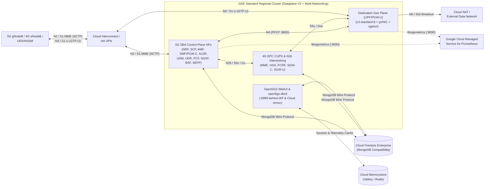
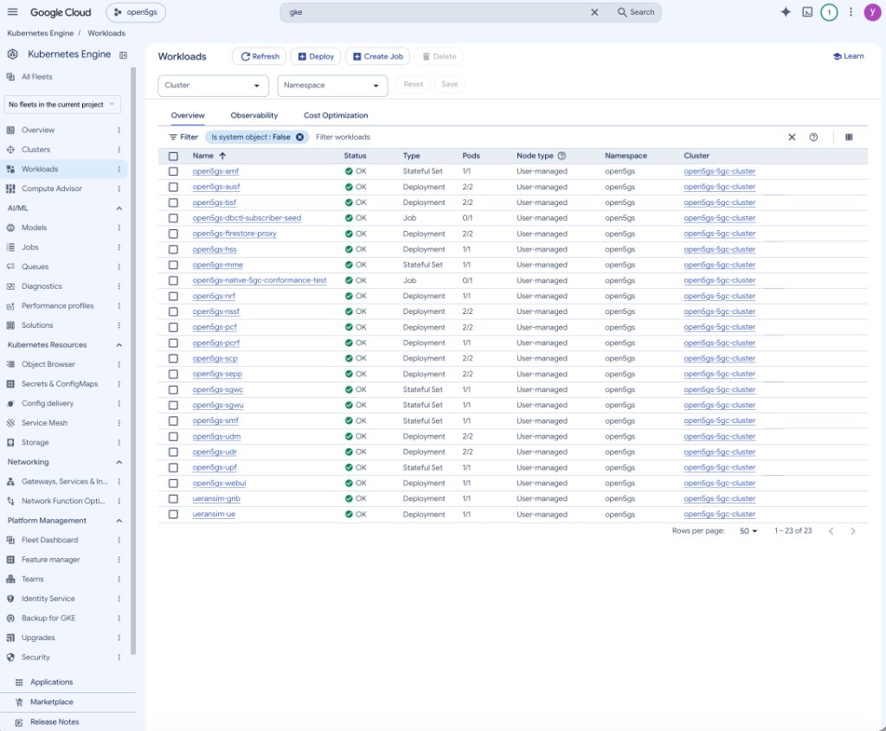
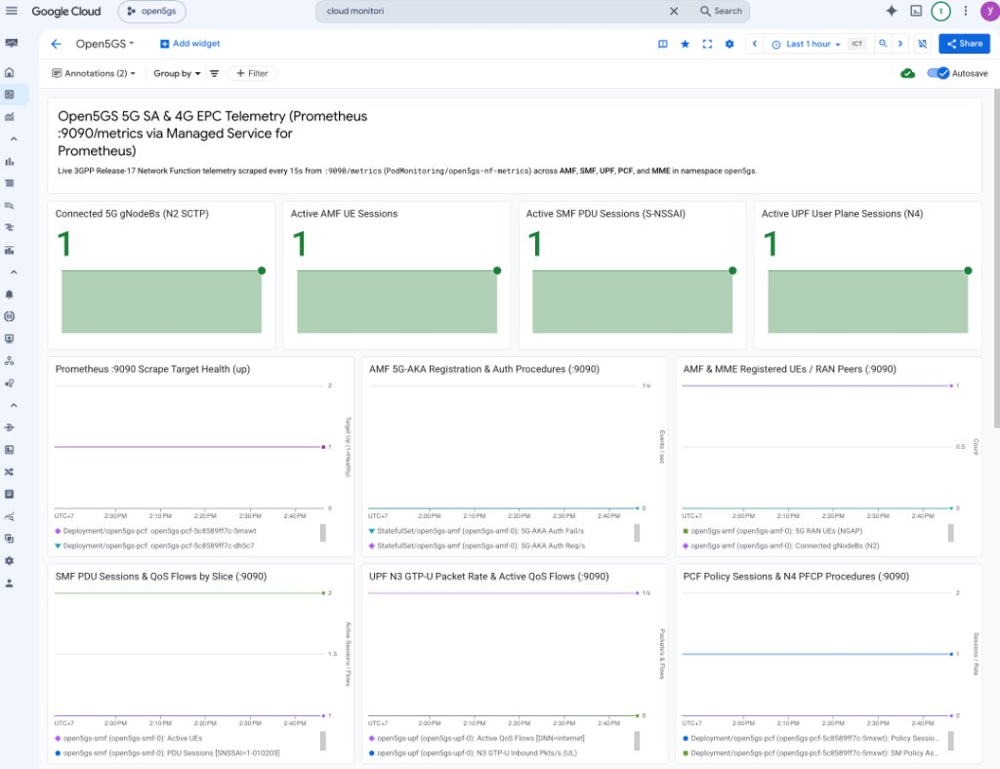
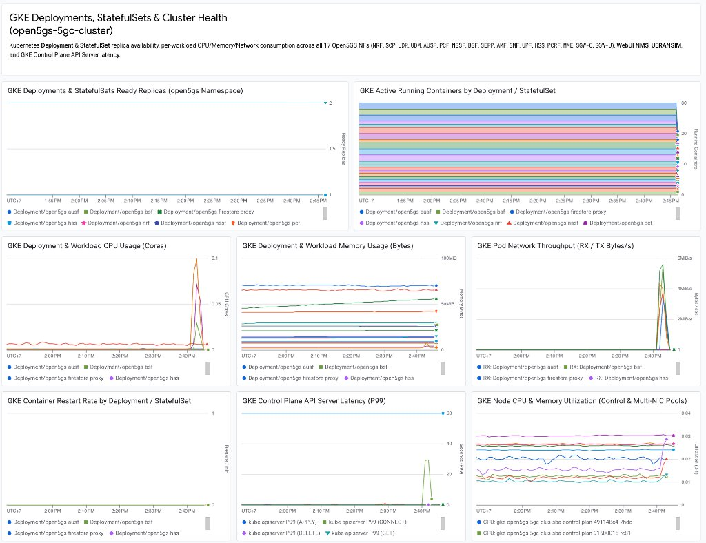

# Open5GS 5G Standalone (5G SA) Core Blueprint on Google Cloud Platform

This repository provides a **Principal Architect Reference Blueprint**, **Terraform Infrastructure-as-Code (IaC)** scripts, and **Google Kubernetes Engine (GKE)** manifests for deploying a complete **3GPP Release-17/18 Open5GS 5G Standalone (5G SA) & 4G EPC CUPS Core**—including a **Multi-NIC User Plane Function (UPF)**, **Cloud Firestore Subscriber Persistence**, **Zero-Trust NMS WebUI**, and **Cloud Monitoring Telemetry**—100% within a **Google Cloud Public Region**.

---

## Architecture Overview



### Key GCP Native Service Mappings (100% Open5GS Component Coverage)
| 5GS / EPC Layer | Open5GS Component & Daemons | Google Cloud Native Service |
| :--- | :--- | :--- |
| **5GC Control Plane (SBA)** | `NRF`, `SCP`, `AMF`, `SMF` (`+PGW-C`), `AUSF`, `UDM`, `UDR`, `PCF`, `NSSF`, `BSF`, `SEPP` | **GKE Standard** (`Dataplane V2` + HTTP/2 Services + Multi-NIC for `N2`/`N4`/`N26`) |
| **5GC & EPC User Plane (CUPS)** | `UPF` (`+PGW-U` `open5gs-upfd` + `ogstun`) & `SGW-U` (`open5gs-sgwud`) | **GKE Standard C3 Node Pool** (`c3-standard-8`, `gVNIC`, Multi-NIC `N3`/`S1-U`/`N4`/`N6` with `MTU 8896`, **Cloud NAT**) |
| **4G EPC / 5G NSA / N26 Plane** | `MME` (`open5gs-mmed`), `HSS` (`open5gs-hssd`), `PCRF` (`open5gs-pcrfd`), `SGW-C` (`open5gs-sgwcd`) + `freeDiameter` | **GKE Standard** (`StatefulSet`/`Deployment` + Multi-NIC `S1-MME` SCTP `:36412`, `S11`/`N26` GTPv2-C `:2123`, `S6a`/`Gx`/`Rx`/`Cx` Diameter `:3868`/`:5868`) |
| **Subscriber & Policy DB** | MongoDB (`udrd`, `hssd`, `pcfd`, `pcrfd`, `webui`, `open5gs-dbctl`) | **Cloud Firestore Enterprise with MongoDB Compatibility** *(via `open5gs-firestore-proxy` TLS wire-adapter)* |
| **In-Memory Database** | Session Cache, Policy Cache, & UDSF Adapter | **Cloud Memorystore for Valkey / Redis** (`STANDARD_HA`) |
| **NMS & Observability** | `open5gs-webui` + `open5gs-dbctl` + `libogsmetrics` (`:9090`) + NF Logs | **Cloud Load Balancing** + **Identity-Aware Proxy (IAP)** + **Cloud Armor** + **Managed Service for Prometheus (GMP)** + **Cloud Monitoring (`"Open5GS"` Dashboard)** |
| **5GS E2E Simulation Suite** | **UERANSIM** (`nr-gnb` + `nr-ue`) & **Open5GS Conformance Suite** | **GKE Multi-NIC Simulator Pods** (`net1=N2 SCTP`, `net2=N3 GTP-U`, `uesimtun0`) + **GKE Conformance Job** |

---

## Live Deployment & Cloud Monitoring Snapshots

### 1. GKE Workloads Overview (`23 / 23` Workloads Healthy in `open5gs-5gc-cluster`)
All `15` Deployments, `6` Multi-NIC StatefulSets, and `2` Verification/Seed Jobs running in namespace `open5gs`:



### 2. Cloud Monitoring `"Open5GS"` Dashboard — 3GPP Prometheus Telemetry (`:9090/metrics`)
Real-time `AMF`, `SMF`, `UPF`, `PCF`, and `MME` scorecards and `:9090/metrics` time-series scraped every `15s` via Google Cloud Managed Service for Prometheus:



### 3. Cloud Monitoring `"Open5GS"` Dashboard — GKE Deployments, StatefulSets & Cluster Health
Controller-labeled replica availability, active container counts, CPU/memory usage, pod `RX`/`TX` throughput (capturing live simulated 5G UE speedtest traffic), `0` container restarts, `kube-apiserver` P99 latency, and node pool utilization:



---

## Repository Structure

```text
.
├── README.md                                 # Repository overview and step-by-step Terraform deployment guide
├── design_blueprint.md                       # Comprehensive 5G Principal Architect Design Blueprint
├── walkthrough.md                            # Live GCP Deployment & End-to-End 5G SA Verification Walkthrough
├── UAT_Report.md                             # User Acceptance Testing (UAT) Report, Screenshots & Test SOPs
├── assets/                                   # Cloud Monitoring Dashboard & NMS WebUI UAT Screenshots
├── .gitignore                                # Excludes Terraform state, GCP credentials, SIM keys, and internal plans
├── terraform/
│   ├── main.tf                               # Multi-VPC (SBI, N2, N3, N4, N6), GKE Dataplane V2, Firestore, Memorystore
│   ├── monitoring_dashboard.tf               # Google Cloud Monitoring "Open5GS" Dashboard (:9090 Prometheus + GKE Workloads)
│   ├── outputs.tf                            # Outputs GKE cluster, Firestore URI, Memorystore, and Dashboard URL
│   └── variables.tf                          # Parameterized GCP project, region, zones, PLMN (MCC/MNC), and CIDRs
└── k8s/
    ├── 00-namespace-and-networks.yaml        # Namespace & GKE Multi-Network CRDs (N2, N3, N4, N6)
    ├── 01-control-plane-sba.yaml             # Full 5G SA Control Plane NFs + Firestore Proxy + PodMonitoring
    ├── 02-upf-user-plane.yaml                # Multi-NIC UPF StatefulSet with ogstun & N6 NAT policy routing
    ├── 03-nms-webui-iap.yaml                 # Open5GS WebUI NMS behind External ALB, Cloud Armor, & IAP
    ├── 04-ueransim-ran-ue-simulator.yaml     # In-Cluster UERANSIM (gNodeB + UE) & 3GPP NRF Conformance Job
    └── 05-epc-cups-and-interworking.yaml     # 4G EPC CUPS (MME, HSS, PCRF, SGW-C, SGW-U), N26, freeDiameter & open5gs-dbctl
```

---

## Step-by-Step Deployment Guide Using Terraform

### Prerequisites

1. **Google Cloud Project**: A GCP project with Billing enabled and IAM permissions to provision networking, GKE, Firestore, Memorystore, IAM bindings, and Cloud Monitoring (`roles/owner`, or `roles/compute.networkAdmin`, `roles/container.admin`, `roles/datastore.owner`, `roles/redis.admin`, `roles/monitoring.admin`, and `roles/resourcemanager.projectIamAdmin`).
2. **Required Local CLI Tools**:
   - **Google Cloud SDK (`gcloud`)** `>= 470.0.0` with `gke-gcloud-auth-plugin` installed (`gcloud components install gke-gcloud-auth-plugin`)
   - **Terraform** `>= 1.5.0` (`hashicorp/google` & `hashicorp/google-beta` providers `>= 5.30.0`)
   - **Kubernetes CLI (`kubectl`)** `>= 1.29`

---

### Step 1: Authenticate & Enable Required Google Cloud APIs

Set your target project and region environment variables, authenticate Application Default Credentials (ADC) for Terraform, and enable the required GCP service APIs:

```bash
export PROJECT_ID="<YOUR_GCP_PROJECT_ID>"
export REGION="us-central1"

# Authenticate gcloud CLI and Terraform Application Default Credentials
gcloud auth login
gcloud auth application-default login
gcloud config set project "${PROJECT_ID}"

# Enable required Google Cloud APIs prior to running Terraform
gcloud services enable \
  compute.googleapis.com \
  container.googleapis.com \
  firestore.googleapis.com \
  redis.googleapis.com \
  monitoring.googleapis.com \
  logging.googleapis.com \
  iam.googleapis.com \
  cloudresourcemanager.googleapis.com \
  --project="${PROJECT_ID}"
```

---

### Step 2: Configure Terraform Input Variables (`terraform/`)

Review [`terraform/variables.tf`](terraform/variables.tf). Only `project_id` is strictly required; all other parameters include production-aligned defaults:

| Variable | Default | Description |
| :--- | :--- | :--- |
| `project_id` | *(Required)* | Target Google Cloud Project ID hosting the Open5GS 5G Core. |
| `region` | `"us-central1"` | Primary GCP region for VPC subnets, GKE, Firestore, and Memorystore. |
| `zones` | `["us-central1-a", "us-central1-b", "us-central1-c"]` | Availability zones for regional GKE node pools (`c3-standard-8` requires C3-capable zones). |
| `ran_cidr` | `"172.16.0.0/16"` | External RAN (`gNodeB`/`eNodeB`) CIDR permitted on `N2` SCTP and `N3` GTP-U firewall rules. |
| `ue_pool_cidr` | `"10.45.0.0/16"` | UE PDU Session IPv4 pool allocated by `SMF`/`UPF` on `ogstun`. |
| `plmn_mcc` | `"999"` | 3GPP Mobile Country Code (MCC). |
| `plmn_mnc` | `"70"` | 3GPP Mobile Network Code (MNC). |

Create a local `terraform/terraform.tfvars` file (automatically excluded from Git by [`.gitignore`](.gitignore)):

```bash
cat <<EOF > terraform/terraform.tfvars
project_id = "${PROJECT_ID}"
region     = "${REGION}"
zones      = ["us-central1-a", "us-central1-b", "us-central1-c"]
EOF
```

---

### Step 3: Initialize, Plan & Apply Terraform Scripts

Initialize the Terraform providers, validate the configuration, inspect the execution plan, and provision all GCP infrastructure (~15–20 minutes):

```bash
cd terraform

# 1. Download HashiCorp google & google-beta providers
terraform init

# 2. Validate HCL syntax and provider schemas
terraform validate

# 3. Preview all 25 GCP infrastructure resources
terraform plan -out=tfplan

# 4. Provision the complete GCP 5G Core infrastructure
terraform apply tfplan

# Remove local plan file after apply completes
rm -f tfplan
cd ..
```

#### What Terraform Provisions (`terraform/main.tf` & `terraform/monitoring_dashboard.tf`)
- **5 Isolated VPC Networks & Subnets**:
  - `vpc-sbi-mgmt` (`10.10.0.0/20`, Pods `10.100.0.0/16`, Services `10.200.0.0/20`) + Cloud NAT (`open5gs-sbi-nat`)
  - `vpc-n2-signaling` (`10.20.0.0/24`, Pods `10.120.0.0/20`) for `N2` NGAP / `S1-MME` SCTP & `N26`/`S11` GTPv2-C
  - `vpc-n3-userplane` (`10.30.0.0/24`, Pods `10.130.0.0/20`, Jumbo `MTU 8896`) for `N3` / `S1-U` GTP-U (`:2152`)
  - `vpc-n4-pfcp` (`10.40.0.0/24`, Pods `10.140.0.0/20`, Jumbo `MTU 8896`) for `N4` / `Sxa` PFCP (`:8805`)
  - `vpc-n6-dn` (`10.60.0.0/24`, Pods `10.160.0.0/20`) + Cloud NAT (`open5gs-n6-nat`) for UE internet breakout
- **3GPP Firewall Rules & Cloud Armor WAF**: `allow-n2-s1mme-sctp`, `allow-n3-gtpu-udp`, `allow-n4-pfcp-udp`, and `open5gs-nms-cloud-armor-policy`.
- **GKE Regional Cluster (`open5gs-5gc-cluster`)**: Dataplane V2 (`ADVANCED_DATAPATH`), `enable_multi_networking = true`, Private Nodes, Workload Identity, Managed Service for Prometheus (`GMP`), `sba-control-plane-pool` (`n2-standard-8` + `gVNIC`), and `upf-amf-multinic-pool` (`c3-standard-8` + 5 `gVNIC` NICs).
- **Managed Persistence & Cache**: Cloud Firestore Enterprise (`open5gs-db`, MongoDB-compatible wire protocol, PITR, SCRAM-SHA-256 credentials `open5gs-user` + `roles/datastore.owner`) and Cloud Memorystore Redis 7.2 HA (`open5gs-inmemory-cache`).
- **Cloud Monitoring Dashboard (`"Open5GS"`)**: 19-widget dashboard combining Open5GS `:9090/metrics` Prometheus telemetry and controller-labeled GKE workload health.

Verify the Terraform outputs before deploying Kubernetes manifests:

```bash
terraform -chdir=terraform output
```

---

### Step 4: Configure GKE Credentials, Multi-NIC Networks & Kubernetes Secrets

Use the Terraform outputs to fetch `kubectl` credentials, register the GKE secondary L3 networks, and inject the Firestore and Memorystore connection URIs as Kubernetes `Secret` objects:

```bash
# 1. Fetch GKE cluster credentials using Terraform outputs
gcloud container clusters get-credentials \
  "$(terraform -chdir=terraform output -raw gke_cluster_name)" \
  --region="$(terraform -chdir=terraform output -raw gke_cluster_location)" \
  --project="${PROJECT_ID}"

# 2. Create the open5gs namespace and GKE Multi-Network CRDs (N2, N3, N4, N6)
kubectl apply -f k8s/00-namespace-and-networks.yaml

# Verify all secondary GKE networks report NetworkReady=True
kubectl get networks.networking.gke.io,gkenetworkparamsets.networking.gke.io

# 3. Create Kubernetes Secrets directly from Terraform sensitive outputs
kubectl -n open5gs create secret generic open5gs-db-secret \
  --from-literal=db_uri="$(terraform -chdir=terraform output -raw firestore_mongodb_uri)" \
  --dry-run=client -o yaml | kubectl apply -f -

kubectl -n open5gs create secret generic open5gs-redis-secret \
  --from-literal=redis_uri="rediss://$(terraform -chdir=terraform output -raw redis_host):$(terraform -chdir=terraform output -raw redis_port)" \
  --dry-run=client -o yaml | kubectl apply -f -
```

---

### Step 5: Deploy 5G SA Control Plane, Multi-NIC UPF, 4G EPC CUPS & NMS WebUI

Apply the Open5GS Kubernetes manifests in order and synchronize the dynamically assigned GKE Multi-NIC secondary Pod IPs (`net1` / `net2`) into `open5gs-dataplane-endpoints`:

```bash
# 1. Deploy Firestore Wire-Protocol Adapter, 5G SBA Control Plane NFs, & Prometheus PodMonitoring
kubectl apply -f k8s/01-control-plane-sba.yaml
kubectl -n open5gs rollout status deploy/open5gs-firestore-proxy deploy/open5gs-nrf --timeout=180s

# 2. Deploy Dedicated Multi-NIC User Plane Function (UPF/PGW-U on c3-standard-8)
kubectl apply -f k8s/02-upf-user-plane.yaml

# 3. Deploy Open5GS WebUI NMS behind GCE External ALB & Cloud Armor WAF
kubectl apply -f k8s/03-nms-webui-iap.yaml

# 4. Deploy 4G EPC CUPS (MME, HSS, PCRF, SGW-C, SGW-U) & Subscriber Seed Job (IMSI 999700000000001)
kubectl apply -f k8s/05-epc-cups-and-interworking.yaml

# 5. Wait for Multi-NIC StatefulSets (AMF, UPF, SGW-U) to bind secondary NICs
kubectl -n open5gs rollout status statefulset/open5gs-amf statefulset/open5gs-upf statefulset/open5gs-sgwu --timeout=240s

# 6. Populate live secondary interface IPs (N2, N4, Sxa) and restart SMF & SGW-C to establish PFCP associations
kubectl -n open5gs create configmap open5gs-dataplane-endpoints \
  --from-literal=AMF_N2_ADDRESS="$(kubectl -n open5gs exec open5gs-amf-0 -- ip -4 -o addr show dev net1 | awk '{split($4,a,"/"); print a[1]}')" \
  --from-literal=UPF_N4_ADDRESS="$(kubectl -n open5gs exec open5gs-upf-0 -c upfd -- ip -4 -o addr show dev net2 | awk '{split($4,a,"/"); print a[1]}')" \
  --from-literal=SGWU_SXA_ADDRESS="$(kubectl -n open5gs exec open5gs-sgwu-0 -- ip -4 -o addr show dev net2 | awk '{split($4,a,"/"); print a[1]}')" \
  --dry-run=client -o yaml | kubectl apply -f -

kubectl -n open5gs rollout restart statefulset/open5gs-smf statefulset/open5gs-sgwc
kubectl -n open5gs rollout status statefulset/open5gs-smf statefulset/open5gs-sgwc --timeout=180s
```

---

### Step 6: Simulate the Complete 5GS (RAN + UE + User Plane Data Path)

Deploy the in-cluster UERANSIM (`nr-gnb` + `nr-ue`) simulator and 3GPP NRF conformance test job to verify end-to-end 5G-AKA registration, PDU session establishment, and GTP-U internet breakout:

```bash
# 1. Deploy UERANSIM (nr-gnb + nr-ue) & Open5GS 3GPP NRF Conformance Job
kubectl apply -f k8s/04-ueransim-ran-ue-simulator.yaml
kubectl -n open5gs rollout status deploy/ueransim-gnb deploy/ueransim-ue --timeout=180s

# 2. Verify 3GPP TS 29.510 NRF NF-Discovery Conformance Test Job
kubectl -n open5gs logs job/open5gs-native-5gc-conformance-test

# 3. Verify UERANSIM UE Registration & PDU Session Tunnel (uesimtun0)
kubectl -n open5gs logs deploy/ueransim-ue

# 4. Send live User Plane traffic from the simulated UE through N3 GTP-U -> UPF (ogstun) -> N6 Cloud NAT
kubectl -n open5gs exec deploy/ueransim-ue -- ping -I uesimtun0 -c 5 8.8.8.8
kubectl -n open5gs exec deploy/ueransim-ue -- curl -sS --interface uesimtun0 -I https://www.google.com
```

---

### Step 7: Access NMS WebUI & View the `"Open5GS"` Cloud Monitoring Dashboard

1. **Open5GS NMS WebUI**: Wait ~5–8 minutes for the Google Cloud External Application Load Balancer (`open5gs-nms-ingress`) to provision and pass health checks, then retrieve its IP address:
   ```bash
   kubectl -n open5gs get ingress open5gs-nms-ingress
   ```
2. **Google Cloud Monitoring `"Open5GS"` Dashboard**: Provisioned automatically by [`terraform/monitoring_dashboard.tf`](terraform/monitoring_dashboard.tf), combining:
   - **Open5GS `:9090/metrics` Telemetry (Managed Service for Prometheus)**: Real-time scorecards and time-series charts across `AMF`, `SMF`, `UPF`, `PCF`, and `MME` (`gnb`, `amf_session`, 5G-AKA registration/auth rates, PDU sessions & QoS flows by `S-NSSAI`/`5QI`, `N3` GTP-U packet rates & `DNN` flows, `N4` PFCP procedures, and NF process memory/open FDs).
   - **GKE Deployments, StatefulSets & Cluster Health**: Ready replicas across all Deployments and StatefulSets, running containers, per-workload CPU/memory, pod `RX`/`TX` network throughput, container restart rate, `kube-apiserver` P99 latency, and node pool utilization.
   ```bash
   # Print the Google Cloud Console URL for the "Open5GS" dashboard
   terraform -chdir=terraform output -raw monitoring_dashboard_console_url
   ```

For detailed functional verification commands across all 21 workloads and subscriber provisioning SOPs, see [`UAT_Report.md`](UAT_Report.md) and [`walkthrough.md`](walkthrough.md).

---

### Step 8: Infrastructure Teardown & Cleanup (Optional)

To cleanly tear down the environment without leaving orphaned Load Balancer Network Endpoint Groups (NEGs) or forwarding rules, delete the `open5gs` Kubernetes namespace first before running `terraform destroy`:

```bash
# 1. Remove GKE Ingress, Services, and Pods so GCE Load Balancer resources release cleanly
kubectl delete namespace open5gs --wait=true

# 2. Destroy all Terraform-managed GCP infrastructure
cd terraform
terraform destroy
```

---

## Architectural Limitations & Design Considerations

For a deep-dive analysis of deploying Open5GS in a public cloud region—including **Linux kernel `ogstun` throughput limits**, **GCP Load Balancer SCTP (`N2`) handling**, **in-memory `ogs_pool` vs. 3GPP UDSF failover**, **WAN backhaul latency**, and **VPC source-IP anti-spoofing on `N6`**—refer to **[Section 3 of `design_blueprint.md`](design_blueprint.md#3-comprehensive-analysis-of-potential-limitations--mitigations)**.

---

## References
- [Open5GS Official Documentation](https://open5gs.org/open5gs/docs/)
- [Open5GS GitHub Repository](https://github.com/open5gs/open5gs)
