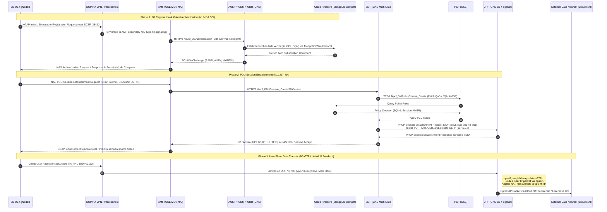
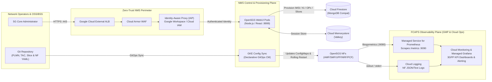

# Design Blueprint: Open5GS 5G Standalone (5G SA) Core on Google Cloud Platform

**Author Role:** 5G Principal Architect  
**Target Topology:** 100% Google Cloud Public Region (Multi-Zone High Availability)  
**3GPP Alignment:** 3GPP Release-17 / Release-18 Service-Based Architecture (SBA) & Control/User Plane Separation (CUPS)  
**Reference Implementation:** [Open5GS](https://open5gs.org/open5gs/docs/) (`v2.7+`)

---

## 1. System Design & Reference Architecture (The "What & Why")

### A. Executive Summary
**Open5GS** is a C-language open-source implementation of the 3GPP 5G Core (5GC) and Evolved Packet Core (EPC). In a **5G Standalone (5G SA)** deployment, the Control Plane uses a cloud-native **Service-Based Architecture (SBA)** communicating over **HTTP/2 REST (`JSON`/`OpenAPI`)**, while the User Plane is decoupled via **PFCP (`N4`)** and transports subscriber data over **GTP-U (`N3`)** and IP routing (`N6`) via a Linux kernel `TUN` interface (`ogstun`).

Deploying a complete 5G System (5GS) 100% within a **Google Cloud Public Region** requires bridging cloud-native microservice patterns (HTTP/2 SBA, NoSQL persistence, Prometheus telemetry) with specialized telco transport requirements (**SCTP** on `N2`, **UDP/GTP-U** jumbo frames on `N3`, **UDP/PFCP** on `N4`, and **Multi-NIC pod isolation**). This blueprint maps every Open5GS component—including the **Network Management System (NMS)**—to Google Cloud Platform (GCP) native services, provides a step-by-step deployment runbook, and transparently documents all software and cloud infrastructure limitations.

---

### B. End-to-End GCP Reference Architecture Diagram

```mermaid
flowchart TB
    subgraph OnPrem_RAN["External RAN / Edge Site (On-Premises or Lab)"]
        UE["5G UE (Subscriber Device / UERANSIM)"]
        gNB["5G gNodeB (RAN)"]
        UE <-->|"NR-Uu (Air Interface)"| gNB
    end

    subgraph GCP_Hybrid["GCP Hybrid Connectivity Perimeter"]
        Interconnect["Cloud Interconnect / HA VPN (IPsec)"]
        Router["Cloud Router (BGP Dynamic Routing)"]
        Interconnect --- Router
    end

    gNB <-->|"N2 (NGAP / SCTP :38412)<br/>N3 (GTP-U / UDP :2152)"| Interconnect

    subgraph GCP_Region["Google Cloud Public Region (e.g., us-central1)"]
        
        subgraph Multi_VPC["Multi-VPC Network Fabric"]
            VPC_SBI["vpc-sbi-mgmt (Primary GKE Network - MTU 1460)<br/>HTTP/2 SBI + Management"]
            VPC_N2["vpc-n2-signaling (Secondary NIC - MTU 1500)<br/>SCTP NGAP Signaling"]
            VPC_N3["vpc-n3-userplane (Secondary NIC - MTU 8896)<br/>GTP-U Encapsulated User Plane"]
            VPC_N4["vpc-n4-pfcp (Secondary NIC - MTU 8896)<br/>PFCP Session Control"]
            VPC_N6["vpc-n6-dn (Secondary NIC - MTU 1500)<br/>External Data Network / Internet Breakout"]
        end

        Router --> VPC_N2
        Router --> VPC_N3

        subgraph GKE_Cluster["GKE Standard Regional Cluster (Dataplane V2 + Multi-Networking)"]
            
            subgraph CP_NodePool["Control Plane Node Pool (n2-standard-8 / c3-standard-4)"]
                AMF["AMF (open5gs-amfd)<br/>N1 / N2 / Namf"]
                SMF["SMF (open5gs-smfd)<br/>N4 / Nsmf"]
                NRF["NRF (open5gs-nrfd)<br/>Nnrf Service Registry"]
                SCP["SCP (open5gs-scpd)<br/>Indirect Routing Mesh"]
                AUSF["AUSF (open5gs-ausfd)<br/>Nausf UE Auth"]
                UDM["UDM (open5gs-udmd)<br/>Nudm Subscription Mgmt"]
                UDR["UDR (open5gs-udrd)<br/>Nudr Data Repository"]
                PCF["PCF (open5gs-pcfd)<br/>Npcf Policy Control"]
                NSSF["NSSF (open5gs-nssfd)<br/>Nnssf Slice Selection"]
                BSF["BSF (open5gs-bsfd)<br/>Nbsf Session Binding"]
                SEPP["SEPP (open5gs-seppd)<br/>N32 Roaming Edge"]
            end

            subgraph UP_NodePool["User Plane Node Pool (c3-standard-8 + gVNIC + Tier-1 Networking)"]
                UPF["UPF (open5gs-upfd)<br/>ogstun Kernel TUN + NAT<br/>N3 (GTP-U) / N4 (PFCP) / N6 (IP)"]
            end
        end

        subgraph Data_Layer["GCP Native Database & In-Memory Layer"]
            Firestore["Cloud Firestore Enterprise<br/>(MongoDB Compatibility Mode)<br/>Subscribers, Ki/OPc, Policies, Slices"]
            Memorystore["Cloud Memorystore for Valkey / Redis Cluster<br/>NMS Session Cache, AF Policy Cache,<br/>& Stateless UDSF Extension Store"]
            SecretMgr["Secret Manager & Certificate Authority Service<br/>SBI mTLS Certificates, N32 SEPP Keys, DB Credentials"]
        end

        subgraph NMS_Layer["Network Management System (NMS) & FCAPS Observability"]
            WebUI["Open5GS WebUI (Node.js / React)<br/>Subscriber & Slice Provisioning Portal"]
            IAP["Cloud Load Balancing + Cloud Armor + IAP<br/>Zero-Trust Operator Access"]
            GMP["Google Cloud Managed Service for Prometheus (GMP)<br/>Scrapes libogsmetrics (:9090) & Node Exporter"]
            Monitoring["Cloud Monitoring & Managed Grafana<br/>5G KPIs (Reg Success, Active PDU, N3 Throughput)"]
            Logging["Cloud Logging & Log Analytics<br/>Centralized NF Structured Logs & Audit Trail"]
            ConfigSync["GKE Config Sync (GitOps)<br/>Declarative YAML ConfigMaps for PLMN/TAC/Slices"]
        end

        CloudNAT["Cloud NAT & Cloud Router<br/>N6 Egress to External Data Network / Internet"]
    end

    %% Connections inside GCP
    VPC_N2 --- AMF
    VPC_N3 --- UPF
    VPC_N4 --- SMF
    VPC_N4 --- UPF
    VPC_N6 --- UPF
    UPF -->|"N6 UE Traffic"| CloudNAT

    AMF <-->|"HTTP/2 SBI"| SCP
    SMF <-->|"HTTP/2 SBI"| SCP
    AUSF <-->|"HTTP/2 SBI"| SCP
    UDM <-->|"HTTP/2 SBI"| SCP
    UDR <-->|"HTTP/2 SBI"| SCP
    PCF <-->|"HTTP/2 SBI"| SCP
    NSSF <-->|"HTTP/2 SBI"| SCP
    BSF <-->|"HTTP/2 SBI"| SCP
    SEPP <-->|"HTTP/2 SBI"| SCP
    SCP <-->|"Service Discovery"| NRF

    UDR <-->|"MongoDB Wire Protocol (TLS)"| Firestore
    PCF <-->|"MongoDB Wire Protocol (TLS)"| Firestore
    WebUI <-->|"MongoDB Wire Protocol (TLS)"| Firestore
    WebUI <-->|"Session & Real-time State"| Memorystore
    PCF -.->|"Policy / Binding Cache"| Memorystore

    IAP --> WebUI
    AMF -.->|"/metrics :9090"| GMP
    SMF -.->|"/metrics :9090"| GMP
    UPF -.->|"/metrics :9090"| GMP
    GMP --> Monitoring
```



---

### C. Complete Open5GS Component-to-GCP Native Service Mapping

The table below maps every component in the Open5GS repository (`src/`, `webui/`, `configs/`) to its target Google Cloud Platform native service, compute profile, and transport interface.

| 5GS Layer | Open5GS Component & Daemon | 3GPP Function & Interfaces | Target GCP Native Service | Compute / Storage Profile & Networking Configuration |
| :--- | :--- | :--- | :--- | :--- |
| **Control Plane (SBA Core)** | **NRF** (`open5gs-nrfd`) | NF Repository Function (`Nnrf`) — Service registration & discovery | **GKE Standard** (`Deployment` + Headless/ClusterIP HTTP/2 `Service`) | Control Plane Node Pool (`n2-standard-8` or `c3-standard-4`); Primary VPC (`vpc-sbi-mgmt`), TCP `:7777` (HTTP/2). |
| **Control Plane (SBA Core)** | **SCP** (`open5gs-scpd`) | Service Communication Proxy — Indirect SBA routing & load balancing | **GKE Standard** (`Deployment`) + **Cloud Service Mesh** (Optional) | Control Plane Node Pool; routes HTTP/2 SBI traffic across NFs; integrates with NRF `:7777`. |
| **Control Plane (RAN Access)** | **AMF** (`open5gs-amfd`) | Access & Mobility Management (`N1`, `N2` NGAP/SCTP, `Namf` HTTP/2) | **GKE Standard** (`StatefulSet`/`Deployment`) with **GKE Dataplane V2 Multi-NIC** | Primary NIC (`eth0`) on `vpc-sbi-mgmt` (HTTP/2 `:7777`); Secondary NIC (`net1`) on `vpc-n2-signaling` exposing **SCTP `:38412`** over HA VPN / Cloud Interconnect. |
| **Control Plane (Session)** | **SMF** (`open5gs-smfd`) | Session Management Function (`Nsmf` HTTP/2, `N4` PFCP/UDP) | **GKE Standard** (`StatefulSet`/`Deployment`) with **GKE Dataplane V2 Multi-NIC** | Primary NIC (`eth0`) on `vpc-sbi-mgmt` (HTTP/2 `:7777`); Secondary NIC (`net1`) on `vpc-n4-pfcp` (`UDP :8805`) to control UPF PDRs/FARs/QERs. |
| **Control Plane (Auth & Security)** | **AUSF** (`open5gs-ausfd`) | Authentication Server Function (`Nausf` HTTP/2) — 5G-AKA / EAP-AKA' | **GKE Standard** (`Deployment` + HPA) | Stateless HTTP/2 microservice on `vpc-sbi-mgmt`; scales horizontally on CPU/RPS. |
| **Control Plane (Subscriber Data)** | **UDM** (`open5gs-udmd`) | Unified Data Management (`Nudm` HTTP/2) — Subscription & auth vectors | **GKE Standard** (`Deployment` + HPA) | Stateless HTTP/2 microservice on `vpc-sbi-mgmt`; queries UDR over HTTP/2 SBI. |
| **Control Plane (Data Repo API)** | **UDR** (`open5gs-udrd`) | Unified Data Repository (`Nudr` HTTP/2 + MongoDB C Driver `libmongoc`) | **GKE Standard** (`Deployment` + HPA) connected to **Cloud Firestore** | Translates 3GPP `Nudr` HTTP/2 calls into `DB_URI` queries against **Cloud Firestore (MongoDB Compatibility)**. |
| **Control Plane (Policy)** | **PCF** (`open5gs-pcfd`) | Policy Control Function (`Npcf` HTTP/2 + `libmongoc`) | **GKE Standard** (`Deployment` + HPA) connected to **Cloud Firestore** | Enforces AM/SM/QoS policies; reads policy rules from **Cloud Firestore (MongoDB Compatibility)**. |
| **Control Plane (Slicing)** | **NSSF** (`open5gs-nssfd`) | Network Slice Selection Function (`Nnssf` HTTP/2) | **GKE Standard** (`Deployment` + HPA) | Evaluates S-NSSAI (`SST`, `SD`) and selects target AMF/NRF set per network slice. |
| **Control Plane (Binding)** | **BSF** (`open5gs-bsfd`) | Binding Support Function (`Nbsf` HTTP/2) | **GKE Standard** (`Deployment` + HPA) | Maps UE IP / SUPI / PDU Session to the serving PCF instance. |
| **Control Plane (Roaming)** | **SEPP** (`open5gs-seppd`) | Security Edge Protection Proxy (`N32c`/`N32f` HTTP/2 PRINS/TLS) | **GKE Standard** (`Deployment`) + **GKE Gateway API / Cloud Armor** | Inter-PLMN roaming perimeter; mTLS certificates managed via **Google Cloud Certificate Authority Service (CAS)** & **Secret Manager**. |
| **User Plane (Data Path)** | **UPF** (`open5gs-upfd`) | User Plane Function (`N3` GTP-U/UDP `:2152`, `N4` PFCP/UDP `:8805`, `N6` IP) | **GKE Standard** (`DaemonSet`/`StatefulSet`) on **Dedicated C3/C4 Node Pool** | `c3-standard-8` (or `c4-standard-8`) with **gVNIC**, **Tier-1 Networking**, Linux kernel `/dev/net/tun` (`ogstun`), `CAP_NET_ADMIN`, 3 secondary NICs (`vpc-n3`, `vpc-n4`, `vpc-n6`), and **Cloud NAT** on `vpc-n6`. |
| **Persistent Database** | **MongoDB** (`udrd`, `pcfd`, `webui`) | Subscriber profiles (`IMSI`/`SUPI`, `Ki`, `OPc`, `AMBR`, `QCI`/`5QI`) | **Cloud Firestore Enterprise (MongoDB Compatibility)** *(Primary)* or **MongoDB Atlas on GCP** | Regional multi-zone serverless document database speaking the MongoDB wire protocol over Private Service Connect / Private Google Access. |
| **In-Memory Database** | **Redis / Valkey** (NMS Session & State Caching) | WebUI sessions, real-time subscriber telemetry cache, AF/NEF rate limiting, & UDSF adapter | **Cloud Memorystore for Valkey** (or **Memorystore for Redis Cluster**) | Sub-millisecond in-memory store with Multi-Zone High Availability and Private Service Connect in `vpc-sbi-mgmt`. |
| **NMS (Provisioning UI)** | **Open5GS WebUI** (`webui/` Node.js + Express + React) | Subscriber CRUD, SIM key provisioning, slice/APN config | **Cloud Run** (or **GKE Deployment**) + **External Application Load Balancer** + **IAP** + **Cloud Armor** | Serverless or GKE container on port `:9999`, protected by **Identity-Aware Proxy (IAP)** for zero-trust workforce authentication and **Cloud Armor** WAF. |
| **NMS (FCAPS & Telemetry)** | **Prometheus Metrics & Logs** (`libogsmetrics`, `stdout`) | Performance Management (PM), Fault Management (FM), Configuration Management (CM) | **Google Cloud Managed Service for Prometheus (GMP)** + **Cloud Monitoring** + **Cloud Logging** + **GKE Config Sync** | Scrapes `:9090/metrics` on AMF, SMF, UPF, PCF; alerts on registration drops/PDU failures; manages NF YAML configs via GitOps (`ConfigSync`). |

---

### D. Architectural Decision Matrix: Compute, Databases, In-Memory, & NMS

#### 1. Container Orchestration: GKE Standard vs. GKE Autopilot
| Chosen GCP Service | Alternative Considered | Decision Rationale & Trade-offs |
| :--- | :--- | :--- |
| **GKE Standard (Regional Cluster with Dataplane V2)** | GKE Autopilot / Compute Engine MIGs | **Why GKE Standard wins:** Open5GS UPF (`open5gs-upfd`) requires creating a virtual TUN device (`ogstun`), enabling kernel IP forwarding (`net.ipv4.ip_forward=1`), applying `iptables` NAT masquerading (`CAP_NET_ADMIN`), and attaching multiple VPC NICs (`N3`, `N4`, `N6`) via **GKE Multi-Networking**. GKE Autopilot restricts privileged host networking, custom kernel `sysctl` tuning, and multi-NIC pod attachments needed by telco user planes. |

#### 2. Persistent Database Options for Open5GS (`UDR`, `PCF`, `WebUI`)
Open5GS natively compiles against `mongo-c-driver` (`libmongoc`) in C for `open5gs-udrd` and `open5gs-pcfd`, and uses `mongoose` (MongoDB ODM) in Node.js for `open5gs-webui`. It does **not** include native SQL/PostgreSQL drivers.

| Database Option on GCP | Native GCP Integration | Open5GS Compatibility | Decision Rationale & Trade-offs |
| :--- | :--- | :--- | :--- |
| **Option 1 (Recommended Native): Cloud Firestore Enterprise with MongoDB Compatibility** | **100% GCP Native** (Serverless, IAM, Cloud KMS CMEK, 99.99% Regional / 99.999% Multi-region SLA) | **Direct Wire Protocol Compatibility** via `DB_URI=mongodb://...` | Eliminates operational overhead of managing MongoDB replica sets. Supports standard MongoDB wire protocol connections from `libmongoc` (`udrd`/`pcfd`) and `mongoose` (`webui`). *Note: Verify index definitions used by `open5gs-dbctl` during PoC (see Section 5 Limitations).* |
| **Option 2 (100% Feature Parity): MongoDB Atlas on Google Cloud (via GCP Marketplace & PSC)** | **GCP Partner Managed** (Runs inside GCP regions, connected via Private Service Connect, billed via GCP Marketplace) | **100% Native MongoDB Engine** | Zero compatibility risk with `libmongoc`, `mongoose`, change streams, or complex aggregations. Recommended if custom subscriber provisioning tools rely on MongoDB-specific operators not yet supported in Firestore MongoDB compatibility mode. |
| **Option 3 (Self-Managed on GKE): Percona Server for MongoDB Operator on GKE + Hyperdisk Balanced** | **GKE Native Infrastructure** (Uses GCE Persistent Disk / Hyperdisk with Regional Replication) | **100% Native MongoDB Engine** | Ideal for air-gapped or single-cluster footprints where external managed services are restricted, at the cost of Day-2 Kubernetes DBA operations. |
| **Option 4 (SQL / NewSQL): AlloyDB for PostgreSQL or Cloud Spanner** | **100% GCP Native** | **Incompatible Out-of-the-Box** (Requires custom `Nudr` translation proxy or C driver rewrite) | While Cloud Spanner and AlloyDB are common in commercial Tier-1 5G cores, Open5GS hardcodes `libmongoc` BSON queries in `src/udr/` and `src/pcf/`. Using AlloyDB/Spanner requires replacing `open5gs-udrd` with a custom 3GPP `Nudr` REST-to-SQL microservice. |

#### 3. In-Memory Database Options on GCP
In a 5G System, ultra-low-latency (<1 ms) in-memory state management is critical. Below is how GCP in-memory options map to Open5GS today and to 3GPP Release-17/18 stateless architectures:

| GCP In-Memory Service | Target 5GS Role | Architectural Fit & Open5GS Reality Check |
| :--- | :--- | :--- |
| **Cloud Memorystore for Valkey (or Redis Cluster)** *(Recommended)* | **1. NMS / WebUI Session & Telemetry Cache**<br>**2. External AF / NEF Policy & Rate-Limit Cache**<br>**3. Custom Stateless UDSF (Unstructured Data Storage Function)** | **What works out-of-the-box:** Storing Express.js session tokens for horizontally scaled `open5gs-webui` pods, caching subscriber profile lookups for north-bound OSS/BSS APIs, and caching NRF discovery results in custom SCP proxies.<br>**Important Open5GS Reality Check:** Unmodified Open5GS C daemons (`amfd`, `smfd`, `upfd`) store active UE contexts (`amf_ue_t`, `smf_sess_t`) in **local process heap pools (`ogs_pool`)**, *not* in Redis. To use Memorystore as a true 3GPP **UDSF** for hitless AMF/SMF pod failover, an external state-sync sidecar or C hook serializing `amf_ue_t`/`smf_sess_t` to Memorystore is required. |
| **Memorystore for Memcached** | Ephemeral HTTP/2 Lookup Cache | Lacks persistence, pub/sub keyspace notifications, and rich data structures (Hashes/Streams) needed for 5G session binding (`BSF`) and NMS event streaming. **Not recommended** over Memorystore for Valkey/Redis. |

---

### E. Signaling & Data Value Pattern Flowchart



---

### F. Network Management System (NMS) Architecture on GCP

A production 5G Core requires a comprehensive **Network Management System (NMS)** covering **FCAPS** (Fault, Configuration, Accounting, Performance, and Security Management):



1. **Subscriber & Slice Provisioning NMS (`open5gs-webui`)**:
   - Hosted on **GKE** (or **Cloud Run** via Direct VPC Egress) and exposed through a **Google Cloud External Application Load Balancer** with **Google-managed SSL certificates**, **Cloud Armor** DDoS/WAF protection, and **Identity-Aware Proxy (IAP)** so the WebUI is never exposed to unauthenticated internet traffic.
   - Connects to **Cloud Firestore (MongoDB Compatibility)** via `DB_URI` to manage subscriber `SUPI`/`IMSI`, permanent keys (`Ki`), operator keys (`OPc`), `DNN` configurations, and `S-NSSAI` slice definitions.
2. **Performance Management (PM) — Google Cloud Managed Service for Prometheus (GMP)**:
   - Open5GS embeds `libogsmetrics` (`prometheus-client-c`) exposing native 3GPP counters and gauges on `:9090/metrics` across `amfd`, `smfd`, `upfd`, `pcfd`, `udmd`, and `nrfd` (e.g., `fivegs_amffunction_rm_registeredsubnbr`, `fivegs_smffunction_sm_sessionnbr`, `fivegs_upffunction_upf_sessionnbr`, GTP-U N3 bytes/packets).
   - A GKE `PodMonitoring` custom resource scrapes all NFs every `15s` into **GMP** without managing self-hosted Prometheus storage.
3. **Fault Management (FM) — Cloud Logging & Cloud Monitoring Alerting**:
   - All Open5GS daemon logs (`ogs_error`, `ogs_warn`, NGAP/NAS decode traces) stream to **Cloud Logging**. Log-based metrics trigger **Cloud Monitoring** alerts on SCTP association drops (`NGAP_EVENT_SCTP_ASSOC_SHUTDOWN`), PFCP heartbeat timeouts, or authentication failures (`5G-AKA Synch Failure`).
4. **Configuration Management (CM) — GKE Config Sync (GitOps)**:
   - Every Open5GS NF reads a declarative YAML file (`amf.yaml`, `smf.yaml`, `upf.yaml`, etc.). Storing these as Kubernetes `ConfigMap` manifests managed by **GKE Config Sync** provides auditable, version-controlled Configuration Management across environments.

---

## 2. Step-by-Step Deployment Guide in GCP

### Phase 1: Project Foundation & Multi-VPC Network Setup
Open5GS requires network separation across signaling (`N2`), user plane (`N3`), session control (`N4`), external data network (`N6`), and internal SBA (`SBI`).

1. **Enable Required GCP APIs**:
   ```bash
   gcloud services enable \
     compute.googleapis.com \
     container.googleapis.com \
     firestore.googleapis.com \
     redis.googleapis.com \
     secretmanager.googleapis.com \
     monitoring.googleapis.com \
     logging.googleapis.com \
     iap.googleapis.com
   ```
2. **Create Dedicated VPC Networks with Jumbo Frames (`MTU 8896`) on N3 & N4**:
   - GTP-U adds 36–44 bytes of outer IP/UDP/GTP header overhead. Setting `MTU 8896` on `vpc-n3-userplane` and `vpc-n4-pfcp` prevents inner packet IP fragmentation.
   ```bash
   # Primary SBI & Management VPC
   gcloud compute networks create vpc-sbi-mgmt --subnet-mode=custom --mtu=1460
   gcloud compute networks subnets create subnet-sbi \
     --network=vpc-sbi-mgmt --region=us-central1 --range=10.10.0.0/20 \
     --secondary-range=pods-sbi=10.100.0.0/16,services-sbi=10.200.0.0/20

   # N2 SCTP Signaling VPC
   gcloud compute networks create vpc-n2-signaling --subnet-mode=custom --mtu=1500
   gcloud compute networks subnets create subnet-n2 \
     --network=vpc-n2-signaling --region=us-central1 --range=10.20.0.0/24

   # N3 GTP-U User Plane VPC (Jumbo MTU 8896)
   gcloud compute networks create vpc-n3-userplane --subnet-mode=custom --mtu=8896
   gcloud compute networks subnets create subnet-n3 \
     --network=vpc-n3-userplane --region=us-central1 --range=10.30.0.0/24

   # N4 PFCP Control VPC (Jumbo MTU 8896)
   gcloud compute networks create vpc-n4-pfcp --subnet-mode=custom --mtu=8896
   gcloud compute networks subnets create subnet-n4 \
     --network=vpc-n4-pfcp --region=us-central1 --range=10.40.0.0/24

   # N6 External Data Network VPC
   gcloud compute networks create vpc-n6-dn --subnet-mode=custom --mtu=1500
   gcloud compute networks subnets create subnet-n6 \
     --network=vpc-n6-dn --region=us-central1 --range=10.60.0.0/24
   ```
3. **Configure Firewall Rules for 3GPP Protocols (`SCTP :38412`, `UDP :2152`, `UDP :8805`)**:
   ```bash
   # Allow N2 NGAP over SCTP (IP Protocol 132) from RAN CIDR
   gcloud compute firewall-rules create allow-n2-sctp \
     --network=vpc-n2-signaling --allow=sctp:38412 --source-ranges=172.16.0.0/16

   # Allow N3 GTP-U over UDP :2152 from RAN CIDR
   gcloud compute firewall-rules create allow-n3-gtpu \
     --network=vpc-n3-userplane --allow=udp:2152 --source-ranges=172.16.0.0/16

   # Allow N4 PFCP over UDP :8805 between SMF and UPF
   gcloud compute firewall-rules create allow-n4-pfcp \
     --network=vpc-n4-pfcp --allow=udp:8805 --source-ranges=10.40.0.0/24
   ```

### Phase 2: Hybrid RAN Backhaul Connectivity (`N2` & `N3`)
1. Provision **HA VPN** or **Dedicated/Partner Cloud Interconnect** terminating into `vpc-n2-signaling` and `vpc-n3-userplane` (or into a centralized Transit Hub VPC peered with `vpc-n2` and `vpc-n3`).
2. Advertise the AMF `N2` subnet (`10.20.0.0/24`) and UPF `N3` subnet (`10.30.0.0/24`) via **Cloud Router BGP** to the remote gNodeB routers.

### Phase 3: Provision Managed Database & In-Memory Services
1. **Create Cloud Firestore Enterprise Database with MongoDB Compatibility**:
   ```bash
   gcloud alpha firestore databases create \
     --database=open5gs-db \
     --location=us-central1 \
     --type=mongodb-compatible \
     --edition=enterprise
   ```
2. **Create Cloud Memorystore for Valkey Instance** (for NMS sessions & caching):
   ```bash
   gcloud memcache/redis/valkey ... # Or via Terraform google_memorystore_instance
   ```
3. **Store Database URI & mTLS Certificates in Secret Manager**:
   ```bash
   echo -n "mongodb://<user>:<password>@<firestore-mongo-endpoint>:27017/open5gs?tls=true&authMechanism=SCRAM-SHA-256" | \
     gcloud secrets create open5gs-db-uri --data-file=-
   ```

### Phase 4: Provision GKE Standard Cluster with Dataplane V2 & Multi-NIC Node Pools
1. **Create the GKE Regional Cluster with Dataplane V2 (`ADVANCED_DATAPATH`) and Multi-Networking**:
   ```bash
   gcloud container clusters create open5gs-5gc-cluster \
     --region=us-central1 \
     --network=vpc-sbi-mgmt \
     --subnetwork=subnet-sbi \
     --cluster-secondary-range-name=pods-sbi \
     --services-secondary-range-name=services-sbi \
     --enable-dataplane-v2 \
     --enable-multi-networking \
     --enable-ip-alias \
     --workload-pool=${PROJECT_ID}.svc.id.goog \
     --enable-managed-prometheus \
     --machine-type=n2-standard-8 \
     --num-nodes=2
   ```
2. **Create the Dedicated User Plane (UPF) & Multi-NIC Node Pool**:
   - Uses `c3-standard-8` with `GVNIC` and attaches the additional VPC networks (`vpc-n2-signaling`, `vpc-n3-userplane`, `vpc-n4-pfcp`, `vpc-n6-dn`) at the VM level.
   ```bash
   gcloud container node-pools create upf-multinic-pool \
     --cluster=open5gs-5gc-cluster \
     --region=us-central1 \
     --machine-type=c3-standard-8 \
     -- image-type=UBUNTU_CONTAINERD \
     --gvnic \
     --num-nodes=1 \
     --node-labels=workload=5g-dataplane \
     --additional-node-network=network=vpc-n2-signaling,subnetwork=subnet-n2 \
     --additional-node-network=network=vpc-n3-userplane,subnetwork=subnet-n3 \
     --additional-node-network=network=vpc-n4-pfcp,subnetwork=subnet-n4 \
     --additional-node-network=network=vpc-n6-dn,subnetwork=subnet-n6
   ```

### Phase 5: Deploy Open5GS 5GC Control Plane & UPF Manifests
1. Apply the GKE `Network` and `GKENetworkParamSet` CRDs (`k8s/00-namespace-and-networks.yaml`) to bind the secondary node NICs into Kubernetes.
2. Deploy the SBA Control Plane (`k8s/01-control-plane-sba.yaml`):
   - `NRF` starts first, followed by `SCP`, `UDR`, `UDM`, `AUSF`, `PCF`, `NSSF`, `BSF`, `SEPP`, `SMF`, and `AMF`.
3. Deploy the User Plane (`k8s/02-upf-user-plane.yaml`):
   - An init-container or startup script inside the UPF pod creates the `ogstun` device (`ip tuntap add name ogstun mode tun`), assigns the UE pool CIDR (`10.45.0.1/16`), enables `net.ipv4.ip_forward=1`, and adds an `iptables -t nat -A POSTROUTING -s 10.45.0.0/16 ! -o ogstun -j MASQUERADE` rule out the `N6` interface (`net3`).

### Phase 6: Deploy the Network Management System (NMS)
1. Deploy `open5gs-webui` (`k8s/03-nms-webui-iap.yaml`) wired to `open5gs-db-uri` and Memorystore.
2. Enable **Identity-Aware Proxy (IAP)** on the GKE `BackendConfig` so only authorized engineers with the `roles/iap.httpsResourceAccessor` IAM role can access the Subscriber Management Portal.
3. Apply the `PodMonitoring` resources so **Google Cloud Managed Service for Prometheus** automatically ingests Open5GS `:9090/metrics` endpoints into Cloud Monitoring.

### Phase 7: End-to-End Verification with UERANSIM
1. Provision a test subscriber in **Open5GS WebUI** (`IMSI: 999700000000001`, `Ki: 465B5CE8B199B49FAA5F0A2EE238A6BC`, `OPc: E8ED289DEBA952E4283B54E88E6183CA`, `DNN: internet`, `SST: 1`).
2. Deploy **UERANSIM** (`nr-gnb` and `nr-ue`) in a test subnet or on-premises lab connected over HA VPN:
   - Point `gnb.yaml` `amfConfigs` to the AMF `N2` IP (`10.20.0.x:38412`) and `gtpIp` to the `N3` network.
3. Verify:
   - `amfd` logs: `InitialUEMessage`, `Registration accept`, `PDU Session establishment accept`.
   - `upfd` logs: `PFCP associated`, GTP-U tunnel active on `ogstun`.
   - From UERANSIM UE: `ping -I uesimtun0 8.8.8.8` and verify Prometheus counters in **Cloud Monitoring**.

---

## 3. Comprehensive Analysis of Potential Limitations & Mitigations

Deploying an open-source 5G Core (Open5GS) 100% inside a public cloud region introduces specific **software architecture limitations** (inherent to Open5GS) and **cloud infrastructure limitations** (inherent to public cloud networking). Every limitation and its architectural mitigation is detailed below.

> [!WARNING]
> **Critical Principal Architect Review**: Review these 7 limitations carefully before moving from Lab/Trial PoC to a Carrier Production environment.

### Limitation 1: Kernel-Space `ogstun` User Plane Bottleneck (No Native DPDK / SR-IOV / eBPF)
- **Root Cause (Open5GS Software)**: Unlike commercial UPFs (or open-source UPFs built on VPP, DPDK, or eBPF/XDP), `open5gs-upfd` processes GTP-U packets in user space by reading from a UDP socket (`:2152`) and writing decapsulated IP packets into a single Linux kernel `TUN` device (`ogstun`). Every packet incurs two kernel-to-userspace context switches.
- **Impact on GCP**: Single UPF pod throughput typically saturates around **2 Gbps to 5 Gbps** (depending on packet size/IMIX) even on `c3-standard-8` instances with Tier-1 networking, with higher jitter than DPDK/XDP dataplanes.
- **Mitigation**:
  1. Run `open5gs-upfd` on **Compute-Optimized C3 or C4 instances** (`c3-standard-8` / `c4-standard-8`) with **gVNIC** and **MTU 8896** enabled to maximize per-core kernel throughput.
  2. Horizontally shard traffic across **multiple UPF pods** (using **UL-CL / Branching Point** or per-DNN / per-Slice `S-NSSAI` UPF selection in `smf.yaml`).
  3. If >10 Gbps per UPF node is required, pair the Open5GS Control Plane (`amfd`/`smfd` via standard 3GPP `N4` PFCP) with an eBPF or DPDK-accelerated third-party UPF (e.g., `upf-epc`, VPP-UPF, or commercial PFCP-compliant UPF).

### Limitation 2: Lack of Native SCTP Support in GCP Cloud Load Balancers (`N2` Interface)
- **Root Cause (GCP Infrastructure)**: The 3GPP `N2` interface between gNodeB and AMF uses **NGAP over SCTP (IP Protocol 132, port 38412)**. Google Cloud's External and Internal Passthrough Network Load Balancers support `TCP`, `UDP`, `ESP`, `GRE`, and `ICMP`, but **do not natively load-balance raw `SCTP` traffic**.
- **Impact on GCP**: You cannot expose multiple AMF pods behind a standard Kubernetes `Service` of `type: LoadBalancer` with `protocol: SCTP`.
- **Mitigation**:
  1. **Direct Multi-NIC Pod Routing (Recommended)**: Attach a dedicated `vpc-n2-signaling` interface directly to each AMF pod using **GKE Dataplane V2 Multi-Networking**. Connect the RAN via **Cloud HA VPN** or **Cloud Interconnect** (which transparently tunnels IP Protocol 132 / SCTP inside IPsec or VLANs) and configure the gNodeB with the list of AMF `N2` IPs using native **3GPP NGAP Multi-AMF / GUAMI Pool** redundancy.
  2. **SCTP Multi-Homing**: Leverage native SCTP multi-homing across primary and secondary AMF NIC IPs.

### Limitation 3: In-Memory UE Context & Stateful Failover Gap (`ogs_pool` vs. 3GPP UDSF)
- **Root Cause (Open5GS Software)**: While Open5GS externalizes subscriber profiles to MongoDB/Firestore, active runtime state—such as registered UE contexts (`amf_ue_t`), NAS security contexts, active PDU sessions (`smf_sess_t`), and PFCP rules (`upf_sess_t`)—is stored inside **local C process heap memory (`ogs_pool`)**. Open5GS does **not** natively implement a 3GPP **UDSF (Unstructured Data Storage Function)** backed by Redis/Memorystore.
- **Impact on GCP**: If a GKE node drains or an `amfd`, `smfd`, or `upfd` pod restarts during a GKE upgrade, active UEs anchored on that pod will lose their active session state and must re-register / re-establish PDU sessions.
- **Mitigation**:
  1. Deploy multiple AMF, SMF, and UPF instances (`StatefulSet` with fixed identities) so a single pod restart only affects a shard of UEs.
  2. Configure **GKE PodDisruptionBudgets (PDB)**, **Maintenance Windows**, and ** Maintenance Exclusions** to prevent unscheduled node drain during peak traffic hours.
  3. Use **Cloud Memorystore for Valkey** for all externalized state (NMS WebUI sessions, north-bound AF API caching, and custom state-checkpointing sidecars).

### Limitation 4: 100% Public Cloud Region Latency & Backhaul Hairpinning (`N3` User Plane)
- **Root Cause (Topology)**: Hosting both the Control Plane and the `UPF` inside a centralized Google Cloud Public Region means all subscriber user-plane traffic (`N3` GTP-U) must traverse the WAN backhaul (Cloud Interconnect or HA VPN) from the cell site/RAN to the GCP Region before breaking out to the internet (`N6`).
- **Impact on GCP**:
  - Adds WAN round-trip latency (typically **10 ms – 35 ms** depending on distance to the nearest GCP Region), which is fine for **eMBB** (broadband) and **mMTC** (IoT), but cannot meet sub-5ms **URLLC** (Ultra-Reliable Low-Latency Communications) SLAs.
  - Consumes Cloud Interconnect / VPN bandwidth and incurs GCP egress charges for all subscriber download traffic returning over `N3`.
- **Mitigation**:
  - Use **Dedicated Cloud Interconnect** in the closest metropolitan Point of Presence (PoP) to minimize N2/N3 RTT.
  - When low-latency local breakout is required in future phases, keep the SBA Control Plane in the GCP Region and deploy remote `UPF` pods at the edge via **Google Distributed Cloud (GDC) Connected** controlled over `N4` (PFCP).

### Limitation 5: GCP VPC Source-IP Anti-Spoofing & UE Subnet Routing on `N6`
- **Root Cause (GCP VPC Architecture)**: Google Cloud VPCs enforce strict IP anti-spoofing; packets emitted by a VM/pod NIC whose source IP does not match the NIC's assigned primary IP or Alias IP range are dropped by the Andromeda virtual network unless `canIpForward` is enabled or NAT is applied.
- **Impact on GCP**: Subscriber packets arriving from `ogstun` have source IPs from the UE pool (e.g., `10.45.0.0/16`), which do not belong to the `vpc-n6-dn` subnet (`10.60.0.0/24`).
- **Mitigation**:
  1. **For Internet Breakout (`DNN: internet`)**: Configure `iptables -t nat -A POSTROUTING -s 10.45.0.0/16 ! -o ogstun -j MASQUERADE` inside the UPF pod so UE traffic is SNATed to the UPF pod's `N6` NIC IP before hitting **Cloud NAT**.
  2. **For Private Enterprise DNNs (No SNAT / Preserving UE IP)**: Enable `--can-ip-forward` on the UPF GKE nodes and create a GCP VPC custom static route (`10.45.0.0/16` $\rightarrow$ next-hop UPF `N6` VM IP) so return traffic from private enterprise servers routes back to the UPF.

### Limitation 6: Cloud Firestore (MongoDB Compatibility) Query & Operator Nuances
- **Root Cause (Database Engine)**: Cloud Firestore with MongoDB Compatibility implements the MongoDB wire protocol on top of Firestore's distributed storage engine. While standard CRUD operations (`find`, `insertOne`, `updateOne`, `deleteOne`) used by `open5gs-udrd` and `open5gs-pcfd` work seamlessly, certain administrative commands or unindexed `$regex`/aggregation stages in third-party OSS tools may differ from native `mongod`.
- **Mitigation**:
  - Pre-create required composite indexes on `imsi` (`supi`) and `sst` during deployment.
  - If 100% native `mongod` behavior is required by external OSS integrations, switch the Terraform `DB_URI` to **MongoDB Atlas on GCP** connected via Private Service Connect with zero architecture changes.

### Limitation 7: Lack of Native 3GPP Voice (IMS / VoNR) & Charging (CHF) in Core Open5GS
- **Root Cause (Open5GS Scope)**: Open5GS provides the 5G Packet Core (`AMF`, `SMF`, `UPF`, `PCF`, `UDM`, `UDR`, `AUSF`, `NRF`, `NSSF`, `BSF`, `SCP`, `SEPP`), but does **not** include a built-in IP Multimedia Subsystem (**IMS** for VoNR/VoLTE) or an Online/Offline **Charging Function (CHF / `Nchf`)**.
- **Mitigation**:
  - For **VoNR (Voice over New Radio)**, integrate **Kamailio IMS** + **RTPengine** in a dedicated GKE namespace connected to a separate `ims` DNN on the UPF.
  - For **5G Charging (`Nchf`)**, deploy an external 3GPP-compliant CHF (e.g., OpenCHF or CGrates) alongside Open5GS.

---

## 4. Capacity Sizing, Cost Modeling, & Security Guardrails

### A. Reference Capacity Sizing (Baseline 10,000 Active Subscribers / 2 Gbps User Plane)

| Component Tier | GKE Node Pool / GCP Resource | Sizing Specification | Estimated Monthly GCP Cost (us-central1, On-Demand) |
| :--- | :--- | :--- | :--- |
| **Control Plane Node Pool** (`AMF`, `SMF`, `NRF`, `SCP`, `AUSF`, `UDM`, `UDR`, `PCF`, `NSSF`, `BSF`, `SEPP`, `WebUI`) | `n2-standard-8` (8 vCPU, 32 GB RAM) $\times$ 2 Nodes (Multi-Zone HA) | `Num Nodes = ceil(Total CP Pod CPU / 6.5 allocatable vCPU)` | ~\$495 / month (Eligible for 1-yr / 3-yr CUDs up to 55% off) |
| **User Plane Node Pool** (`UPF` Multi-NIC Dataplane) | `c3-standard-8` (8 vCPU, 32 GB RAM, gVNIC) $\times$ 2 Nodes (Active/Active Sharded) | Supports ~3–5 Gbps aggregate GTP-U throughput per node | ~\$590 / month |
| **Subscriber & Policy DB** | **Cloud Firestore Enterprise (MongoDB Compatibility)** | 10,000 subscriber docs (<1 GB storage) + ~500 ops/sec | ~\$50 – \$120 / month (Pay-per-op / provisioned throughput) |
| **In-Memory Cache** | **Cloud Memorystore for Valkey** | `M1` / `Standard-HA` (5 GB, Multi-Zone) | ~\$160 / month |
| **NMS Security & Observability** | **Cloud Load Balancing + IAP + GMP + Cloud Logging** | 1 External ALB + ~150 Prometheus time series | ~\$85 / month |
| **Total Estimated Core Run-Rate** | *Excludes Cloud Interconnect / HA VPN data egress* | **Complete 5G SA Core + NMS** | **~\$1,380 – \$1,450 / month** |

### B. Security & Telco Guardrails
1. **Service-Based Interface (SBI) mTLS**: Enable TLS 1.3 (`use_tls: true` in Open5GS `sbi:` config blocks) across all HTTP/2 NFs using certificates issued by **Google Cloud Certificate Authority Service (CAS)** and mounted via **Secret Manager CSI Driver**.
2. **Cryptographic Subscriber Key Protection (`Ki` / `OPc`)**: Encrypt Cloud Firestore and GKE Persistent Disks with **Cloud KMS Customer-Managed Encryption Keys (CMEK)** so permanent SIM authentication keys (`Ki` and `OPc`) are protected at rest under customer-controlled key rotation.
3. **Zero-Trust NMS Perimeter**: Never expose `open5gs-webui` (`:9999`) via a public IP or unauthenticated NodePort. Enforce **Identity-Aware Proxy (IAP)** with Context-Aware Access policies and **Cloud Armor** rate-limiting rules.
4. **Network Isolation**: Enforce **GKE Dataplane V2 `NetworkPolicy`** so the UPF `N3`/`N6` interfaces cannot reach the Control Plane `vpc-sbi-mgmt` or `Cloud Firestore` endpoints; only `N4` (`UDP :8805` from `SMF`) and Prometheus scraping (`TCP :9090` from `GMP`) are permitted to reach the `UPF` pod.

---

## 5. Reference Code & Manifests in This Workspace

The companion starter templates for deploying this blueprint are included in this repository:
- **Terraform Infrastructure (`terraform/`)**:
  - [variables.tf](file:///usr/local/google/home/pangyun/Projects/open5gs/terraform/variables.tf): Parameterized GCP project, region, PLMN (`mcc`/`mnc`), and multi-VPC CIDR blocks.
  - [main.tf](file:///usr/local/google/home/pangyun/Projects/open5gs/terraform/main.tf): Multi-VPC networks (`MTU 8896` on `N3`/`N4`), SCTP/GTP-U/PFCP firewall rules, GKE Standard Regional Cluster with Dataplane V2 Multi-Networking, C3 Multi-NIC UPF Node Pool, Cloud Firestore (MongoDB Compatibility), and Cloud Memorystore.
- **Kubernetes Manifests (`k8s/`)**:
  - [00-namespace-and-networks.yaml](file:///usr/local/google/home/pangyun/Projects/open5gs/k8s/00-namespace-and-networks.yaml): `open5gs` namespace and GKE Multi-Network `Network` / `GKENetworkParamSet` CRDs for `N2`, `N3`, `N4`, and `N6`.
  - [01-control-plane-sba.yaml](file:///usr/local/google/home/pangyun/Projects/open5gs/k8s/01-control-plane-sba.yaml): Full 3GPP SBA Control Plane deployments (`NRF`, `SCP`, `UDR`, `UDM`, `AUSF`, `PCF`, `NSSF`, `BSF`, `SEPP`, `SMF`, `AMF`) + `PodMonitoring` for Google Cloud Managed Service for Prometheus.
  - [02-upf-user-plane.yaml](file:///usr/local/google/home/pangyun/Projects/open5gs/k8s/02-upf-user-plane.yaml): Multi-NIC `open5gs-upfd` deployment with `ogstun` kernel TUN initialization, `CAP_NET_ADMIN`, and N6 NAT masquerading.
  - [03-nms-webui-iap.yaml](file:///usr/local/google/home/pangyun/Projects/open5gs/k8s/03-nms-webui-iap.yaml): Open5GS WebUI NMS deployment backed by Firestore & Memorystore and secured behind Google Cloud Load Balancing, Cloud Armor, and Identity-Aware Proxy (IAP).

---

## 6. Legal Disclaimers & Delivery Hand-off

> [!IMPORTANT]
> **Standard "As-Is" Advisory Disclaimer**  
> This architecture blueprint and the accompanying Terraform/Kubernetes manifests are provided strictly for advisory, evaluation, and reference architecture purposes. Google provides these assets **"as-is"** without warranties, carrier-grade SLA guarantees on third-party open-source software (Open5GS), or production support commitments.

> [!WARNING]
> **Customer Engineering Ownership Boundary**  
> The customer’s internal telecommunications and cloud engineering teams retain 100% ownership of RF/RAN integration, PLMN numbering, cryptographic SIM key management (`Ki`/`OPc`), security hardening, and production deployment execution.
